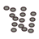
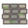
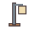
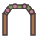

# 建造清单

68 种建造物，图标为项目原创 SVG。所有配方均需要附近的建造工作台。

| 图标 | 名称 | 分类 | 木材 | 铁锭 | 矿石 | 场地 |
| --- | --- | --- | ---: | ---: | ---: | --- |
|  | 木凳 | 座椅 | 2 | 0 | 0 | 室内与户外 |
|  | 圆木桌 | 桌台 | 6 | 0 | 0 | 室内与户外 |
|  | 魔女书柜 | 柜架 | 10 | 1 | 0 | 室内 |
|  | 软垫沙发 | 座椅 | 8 | 1 | 0 | 室内 |
|  | 书写桌 | 桌台 | 6 | 1 | 0 | 室内 |
|  | 星纹小床 | 床铺 | 12 | 2 | 0 | 室内 |
|  | 木箱 | 柜架 | 8 | 0 | 0 | 室内与户外 |
|  | 建造工作台 | 工坊 | 16 | 2 | 0 | 室内与户外 |
|  | 尖顶木栅栏 | 围栏 | 3 | 0 | 0 | 户外 |
|  | 原木栅栏 | 围栏 | 4 | 0 | 0 | 户外 |
|  | 格纹栅栏 | 围栏 | 4 | 0 | 0 | 户外 |
|  | 矮石墙 | 围栏 | 0 | 0 | 5 | 户外 |
|  | 铁艺栅栏 | 围栏 | 0 | 3 | 0 | 户外 |
|  | 常绿树篱 | 围栏 | 2 | 0 | 1 | 户外 |
|  | 木栅门 | 围栏 | 6 | 1 | 0 | 户外 |
|  | 铁栅门 | 围栏 | 2 | 4 | 0 | 户外 |
|  | 木板小径 | 地面 | 2 | 0 | 0 | 户外 |
|  | 石板小径 | 地面 | 0 | 0 | 2 | 户外 |
|  | 红砖小径 | 地面 | 0 | 0 | 3 | 户外 |
|  | 碎石小径 | 地面 | 0 | 0 | 1 | 户外 |
|  | 苔石小径 | 地面 | 1 | 0 | 2 | 户外 |
|  | 圆石步道 | 地面 | 0 | 0 | 2 | 户外 |
|  | 原木单人床 | 床铺 | 14 | 0 | 0 | 室内 |
|  | 花布双人床 | 床铺 | 24 | 2 | 0 | 室内 |
|  | 帷幔床 | 床铺 | 30 | 3 | 0 | 室内 |
|  | 月牙吊床 | 床铺 | 12 | 1 | 0 | 户外 |
|  | 木质靠背椅 | 座椅 | 4 | 0 | 0 | 室内与户外 |
|  | 绒布扶手椅 | 座椅 | 8 | 1 | 0 | 室内 |
|  | 长木凳 | 座椅 | 6 | 0 | 0 | 室内与户外 |
|  | 摇椅 | 座椅 | 10 | 1 | 0 | 室内与户外 |
|  | 花园长椅 | 座椅 | 8 | 2 | 0 | 户外 |
|  | 方木桌 | 桌台 | 8 | 0 | 0 | 室内与户外 |
|  | 长餐桌 | 桌台 | 16 | 1 | 0 | 室内 |
|  | 茶几 | 桌台 | 6 | 0 | 0 | 室内 |
|  | 野餐桌 | 桌台 | 18 | 2 | 0 | 户外 |
|  | 双门衣柜 | 柜架 | 20 | 2 | 0 | 室内 |
|  | 餐具柜 | 柜架 | 16 | 2 | 0 | 室内 |
|  | 矮书架 | 柜架 | 8 | 0 | 0 | 室内与户外 |
|  | 陈列架 | 柜架 | 10 | 1 | 0 | 室内 |
|  | 橡木桶 | 柜架 | 6 | 1 | 0 | 室内与户外 |
|  | 烛台 | 灯具 | 1 | 1 | 0 | 室内与户外 |
|  | 提灯 | 灯具 | 2 | 2 | 0 | 室内与户外 |
|  | 落地灯 | 灯具 | 6 | 2 | 0 | 室内 |
|  | 庭院灯柱 | 灯具 | 8 | 3 | 0 | 户外 |
|  | 蘑菇灯 | 灯具 | 4 | 1 | 2 | 室内与户外 |
|  | 水晶灯 | 灯具 | 0 | 2 | 6 | 室内与户外 |
|  | 椭圆地毯 | 装饰 | 4 | 0 | 0 | 室内 |
|  | 圆形地毯 | 装饰 | 4 | 0 | 0 | 室内 |
|  | 星月地毯 | 装饰 | 6 | 0 | 0 | 室内 |
|  | 穿衣镜 | 装饰 | 6 | 1 | 3 | 室内 |
|  | 座钟 | 装饰 | 4 | 2 | 0 | 室内 |
|  | 风景画架 | 装饰 | 6 | 0 | 0 | 室内与户外 |
|  | 星球仪 | 装饰 | 4 | 2 | 2 | 室内 |
|  | 陶瓷花瓶 | 装饰 | 0 | 0 | 4 | 室内与户外 |
|  | 小鱼缸 | 装饰 | 4 | 2 | 4 | 室内 |
|  | 八音盒 | 装饰 | 4 | 3 | 0 | 室内 |
|  | 花槽 | 庭院 | 6 | 0 | 1 | 户外 |
|  | 陶土花盆 | 庭院 | 0 | 0 | 3 | 室内与户外 |
|  | 香草盆 | 庭院 | 4 | 0 | 2 | 室内与户外 |
|  | 蔷薇拱门 | 庭院 | 16 | 2 | 0 | 户外 |
|  | 鸟浴盆 | 庭院 | 0 | 1 | 8 | 户外 |
|  | 稻草人 | 庭院 | 8 | 0 | 0 | 户外 |
|  | 石井 | 庭院 | 10 | 2 | 12 | 户外 |
|  | 日晷 | 庭院 | 0 | 1 | 6 | 户外 |
|  | 织布架 | 工坊 | 14 | 2 | 0 | 室内与户外 |
|  | 纺车 | 工坊 | 12 | 1 | 0 | 室内与户外 |
|  | 陶窑 | 工坊 | 4 | 4 | 16 | 户外 |
|  | 魔女坩埚 | 工坊 | 4 | 6 | 4 | 室内与户外 |
