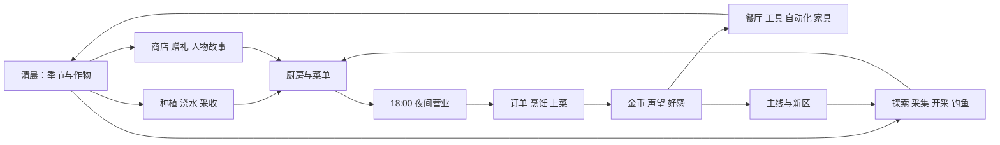

# 哗啦啦魔女镇：四季与月灯食堂

本文件是开发文档，操作方法仅保留在这里。运行内容以 `content.gd` 和 `campaign_state.gd` 为准。

## 游戏定位与背景

薇尔莉娅在雾港后厨工作三年后，响应公开招租，试营月芽农场与月灯食堂一年。她从第一锅汤、当地作物和货船合单开始，在经营失误后学习兑现有限的承诺。月环是公共设施调配与报汛装置：旧临时接线长期依赖守环魔女椿手动值守，椿受伤后主动停机，仍在南方养伤并与镇上通信。居民先恢复水门和河口的独立支路，在冬末降雨中检验分工，最后协商续租与休息日。第十章之后继续自由经营，其他四条支路留作未来生活。

## 参考玩法与本作取舍

本作使用原创人物、对白、作物、菜品和像素资产。参考的是玩法结构：季节农业与居民关系、探索资源推动设备成长、白天准备和夜间食堂经营。

- [星露谷物语官方介绍](https://www.stardewvalley.net/about/)：农业、钓鱼、采集和小镇生活相互连接。
- [多洛可小镇开发者商店介绍](https://store.steampowered.com/app/2285550/Doloc_Town/)：探索、农业和自动化构成成长链。
- [东方夜雀食堂开发者商店介绍](https://store.steampowered.com/app/1584090/)：白天采集、夜间经营与客人故事相连。

## 完整循环



每天有效计时14分钟：06:00–18:00为9分钟采集准备阶段；18:00自动回餐厅并停钟等待玩家制定菜单、确认开业；18:00–22:00为完整5分钟营业阶段，到点自动关门结算。新游戏菜单为空，次日沿用玩家菜单，开业前可调整；提前开业跳至18:00。准备等待、结算与模态界面暂停。每季28天，每年112天。作物只在已浇水的跨日结算中生长。换季时不适应新季节的作物清空为耕地，温室保护全部田地。未浇水不生长但不直接死亡。库存跨天、跨季保留，以便四季宴席备料。

早期可用森林三种食材和基础三道菜获得金币；初始提供香草种子12颗、月白萝卜6颗、胡萝卜4颗、生菜4颗，鸡蛋、牛奶、面粉、油、盐、稻米各4份。开场开放试营；第一章累计上菜8次奖励70金。

中期把矿石和木材投入冶炼、装备与餐厅，把季节蔬菜加工为售价更高的料理；收集零件后获得洒水器、磨粉机和蜂箱，减少日常劳动。后期跨季备料、珍稀鱼获、居民终章与宴会菜构成长期目标。

## 开场动画分镜

新游戏播放五段共30秒的镜头：雾港后厨三年 → 公开招租告示 → 带锅上路 → 已经停机多年的月环 → 农场小屋。告示固定钉在板上，不再出现匿名信飘落或主角到达时月环熄灭的演出。复用现有导出素材，整数缩放，不改原稿。

动画结束或略过后，顺序播放码头、农场、食堂三个场景中的43句对白：码头澪10句、农场门前萤萝15句、食堂奥萝与陶陶18句。人物使用现有原生精灵入场，萤萝保留从农场道路走近的动画。食堂场景开放免租试营，不另扣房地产服务的承租费用。主角默认名字和旧档自定义名字保留。

`campaign.opening_stage` 保存当前段；中断后从该段开头恢复。每段结束保存，全部完成后 `guide_met=true` 并恢复自由活动。动画略过不会略过开场对白。普通移动、背包与存档菜单在演出中锁定，对话仍接受原翻页、回看与选项输入。租金、订单退款和固定船期在本次接入中作为故事事件，不新增限日失败、自动扣租或独立货运模拟。

## 主线与解锁

正文使用 `Narrative/Rebuild_20261020/` 的11个原稿，合计436句（开场43句、主线393句）。`rebuilt_story.py` 编译原稿和翻译；`content.gd` 为导出运行资源，不需要运行时读取文本文件。

章节按顺序完成，目标使用实际经营统计。第八章按项检查并消耗修缮材料，其余目标是累计记录；多余的某一种材料不能代替另一种。剧情对白逐句显示发言者和头像，已完成章节可在手记回顾。

|章|标题|目标|数量|金币奖励|
|---|---|---|---:|---:|
|1|第一张菜单|累计上菜|8|70|
|2|凑不满的一船货|累计收获|12|60|
|3|一块地够不够|累计鱼获|5|80|
|4|旧路上的灯|山径调查|6|100|
|5|她最后一次值夜|累计零件|8|100|
|6|一张太大的订单|餐厅等级|1|120|
|7|第一张退单|累计上菜|40|120|
|8|两盏先亮的灯|支路修缮材料|14|160|
|9|雨里的那一晚|累计上菜|60|180|
|10|明天晚点开门|累计上菜|80|300|

第八章材料：铁锭4、旧械零件6、月晶4。叙事中的季节表示剧情先后，不锁定日历日期，不要求玩家空等一年。

完成交付时先记录 `pending_scene`、章节和奖励，再保存；对白读完清除挂起场景并保存。中断后重播本章对白，不再次发钱或扣料。普通经营仍沿用六小时自动存档；剧情分段额外设置保存点。

旧存档保留金币、工具、物资、作物、好感、支线完成记录和已开放区域；旧主线章节存入 `legacy_chapter`，新主线从第一章开始，已在游玩的旧档跳过新开场。新版存档按新版章节恢复。星芒、奥萝和余烬支线中与匿名信、记忆供能相冲突的文本已经替换。

开发与验证见 [GUIDE.md](GUIDE.md)。

## 地图与探索

保留小镇、农场、住宅、食堂、微光采集地、码头、铁匠铺和杂货店。四季手记的探索页包含六个新区域；出发条件由章节和白天阶段共同检查。每个新区域都是实际可行走的40×23格 TileMapLayer，含地面、道路、水体碰撞、六处采集点、两处工具资源和钓点。所有资源行动复用现有移动、工具挥动、浮漂与咬钩状态机。区域身份与日内采集次数写入同一存档。

|区域|完成章节要求|采集资源|工具资源|
|---|---:|---|---|
|萤灯森林|0|蘑菇、莓果、春笋、野蜂蜜|木材|
|余烬石谷|1|矿石、旧械零件、月晶|矿石|
|莲雾湿地|2|莲藕、香草、莓果|木材|
|旧械遗址|4|旧械零件、矿石、松露|矿石|
|霜铃山径|3|山栗、月晶、蘑菇|矿石|
|月环观星台|7|月光花、月晶、雾叶茶|木材|

每处采集点每日2份，次日恢复。树木与矿点每日刷新；矿石累计记录同时推进主线。探索区域没有收费入口，也不会消耗关键故事物品。夜间自动回食堂，防止营业被地图困住。

## 作物与种子

价格单位为金，生长单位为已浇水天数；再生为首收后所需天数，0表示单次作物。每次种植消耗一颗对应种子。肥料每格3金，下一次采收增加一份产量，采收后清除。香草沿用原背包与种子循环；其他作物进入持久化食材仓储。

|作物|季节|生长|再生|种价|售价|基础产量|
|---|---|---:|---:|---:|---:|---:|
|香草|春/夏/秋/冬|3|0|2|3|1|
|月白萝卜|春|3|0|4|11|1|
|琥珀胡萝卜|春/秋|4|0|5|15|1|
|翡翠生菜|春|4|0|5|14|1|
|铃铛豌豆|春|5|2|9|8|2|
|露珠草莓|春|6|3|14|12|2|
|星穗稻|春/夏|6|0|8|18|2|
|绯红番茄|夏|5|2|12|10|2|
|金羽玉米|夏/秋|7|3|14|15|2|
|青玉黄瓜|夏|4|2|9|9|2|
|焰心辣椒|夏|5|2|10|10|2|
|蜜月甜瓜|夏|9|0|20|55|1|
|紫绸茄子|秋|5|3|10|14|2|
|灯笼南瓜|秋|8|0|16|43|1|
|暖砂红薯|秋|5|0|8|22|1|
|风铃小麦|夏/秋|4|0|5|10|2|
|雾叶茶|春/夏/秋|7|3|18|13|2|
|雪心白菜|冬|5|0|8|23|1|
|霜晶萝卜|冬|4|0|7|20|1|
|月光花|秋/冬|8|0|18|48|1|

## 餐厅与菜品

基础三道菜继续使用原备料库存。其余357道菜使用食材仓储，配方检查与扣料在 `start_cook` 中集中完成；重复烹饪不重复扣料。烹饪完成自动端起，角色实际走到对应顾客旁送餐。错单保留手持菜；超时不付款。营业末清理未完成订单和料理，收入只结算一次。

菜品标注汤锅、煎锅、烤炉、料理台或茶炉分类；当前共用现有厨房互动点和一条烹饪任务，不会并行免费生产。菜单容量随食堂升级增加，新菜按餐厅等级开放。初始菜单为空，由玩家选择上架料理。食谱与仓储支持搜索与分类筛选，食谱搜索同时匹配配方食材名称。

|料理|配方|售价|设备分类|开放等级|口味|
|---|---|---:|---|---:|---|
|蘑菇汤|蘑菇×2|12|汤锅|0|暖食/素食|
|莓果派|莓果×2|14|烤炉|0|甜味|
|香草炖菇|蘑菇×1 + 香草×1|18|汤锅|0|暖食/素食|
|月白萝卜汤|月白萝卜×2 + 海盐×1|30|汤锅|0|暖食/清淡|
|琥珀田园沙拉|琥珀胡萝卜×1 + 翡翠生菜×1 + 食用油×1|32|料理台|0|素食/清淡|
|铃铛豌豆饭|铃铛豌豆×1 + 星穗稻×1 + 海盐×1|38|汤锅|0|暖食/素食|
|露珠草莓挞|露珠草莓×1 + 面粉×1 + 牛奶×1|44|烤炉|1|甜味|
|春笋香饭|春笋×1 + 星穗稻×1|34|汤锅|0|素食/清淡|
|香草煎蛋|香草×1 + 鸡蛋×1 + 食用油×1|28|煎锅|0|暖食|
|莓果牛乳|莓果×1 + 牛奶×1|24|茶炉|0|甜味|
|绯红番茄面|绯红番茄×2 + 面粉×1|42|汤锅|0|暖食/素食|
|金羽玉米浓汤|金羽玉米×1 + 牛奶×1|38|汤锅|0|暖食/甜味|
|青玉凉卷|青玉黄瓜×1 + 星穗稻×1|32|料理台|0|素食/清淡|
|焰心香煎鱼|银鳞鱼×1 + 焰心辣椒×1 + 食用油×1|46|煎锅|1|鱼鲜/辛香|
|蜜月冰沙|蜜月甜瓜×1 + 野蜂蜜×1|78|料理台|1|甜味|
|潮汐虾饭|潮汐虾×1 + 星穗稻×1|52|汤锅|1|鱼鲜/暖食|
|莲塘凉拌|莲藕×1 + 青玉黄瓜×1 + 海盐×1|42|料理台|0|素食/清淡|
|紫绸煎茄|紫绸茄子×2 + 食用油×1|44|煎锅|1|素食/暖食|
|灯笼南瓜煲|灯笼南瓜×1 + 牛奶×1|64|汤锅|1|暖食/甜味|
|暖砂烤红薯|暖砂红薯×2|50|烤炉|1|甜味/暖食|
|山栗焖饭|山栗×1 + 星穗稻×1|44|汤锅|1|暖食/素食|
|风铃面包|风铃小麦×2 + 牛奶×1|44|烤炉|1|暖食|
|松露奶油面|松露×1 + 面粉×1 + 牛奶×1|72|汤锅|2|珍馐/暖食|
|雪心暖锅|雪心白菜×2 + 蘑菇×1|60|汤锅|1|暖食/素食|
|霜晶清汤|霜晶萝卜×2 + 海盐×1|52|汤锅|1|暖食/清淡|
|月光花糕|月光花×1 + 面粉×1 + 野蜂蜜×1|88|烤炉|2|甜味/珍馐|
|雾叶清茶|雾叶茶×1|22|茶炉|0|茶香/清淡|
|蜜香花茶|雾叶茶×1 + 野蜂蜜×1|38|茶炉|1|茶香/甜味|
|溪花鱼羹|溪花鲤×1 + 香草×1|44|汤锅|1|鱼鲜/清淡|
|月影烤鲈|月影鲈×1 + 海盐×1|54|煎锅|1|鱼鲜/暖食|
|雨纹鳗鱼饭|雨纹鳗×1 + 星穗稻×1 + 食用油×1|72|煎锅|2|鱼鲜/暖食|
|莲灯清蒸|莲灯鱼×1 + 莲藕×1|88|汤锅|2|鱼鲜/珍馐/清淡|
|霜尾香烤|霜尾鳟×1 + 香草×1|62|烤炉|2|鱼鲜/暖食|
|星河宴|星河锦鲤×1 + 月光花×1 + 星穗稻×1|140|汤锅|3|鱼鲜/珍馐|
|四季团圆盘|月白萝卜×1 + 绯红番茄×1 + 灯笼南瓜×1 + 雪心白菜×1|130|料理台|3|素食/珍馐|
|万家灯火甜点|露珠草莓×1 + 月光花×1 + 牛奶×1 + 野蜂蜜×1|110|烤炉|3|甜味/珍馐|
|苹果酸奶碗|苹果×1 + 酸奶×1|45|料理台|0|甜味/清淡|
|苹果奶昔|苹果×1 + 牛奶×1|40|茶炉|0|甜味|
|苹果黄油挞|苹果×1 + 面粉×1 + 黄油×1|60|烤炉|1|甜味|
|苹果糖煮果|苹果×2 + 砂糖×1|55|汤锅|0|甜味|
|苹果果茶|苹果×1 + 雾叶茶×1|50|茶炉|0|茶香/清淡|
|梨酸奶碗|梨×1 + 酸奶×1|45|料理台|0|甜味/清淡|
|梨奶昔|梨×1 + 牛奶×1|40|茶炉|0|甜味|
|梨黄油挞|梨×1 + 面粉×1 + 黄油×1|60|烤炉|1|甜味|
|梨糖煮果|梨×2 + 砂糖×1|55|汤锅|0|甜味|
|梨果茶|梨×1 + 雾叶茶×1|50|茶炉|0|茶香/清淡|
|桃子酸奶碗|桃子×1 + 酸奶×1|50|料理台|0|甜味/清淡|
|桃子奶昔|桃子×1 + 牛奶×1|45|茶炉|0|甜味|
|桃子黄油挞|桃子×1 + 面粉×1 + 黄油×1|65|烤炉|1|甜味|
|桃子糖煮果|桃子×2 + 砂糖×1|65|汤锅|0|甜味|
|桃子果茶|桃子×1 + 雾叶茶×1|55|茶炉|0|茶香/清淡|
|樱桃酸奶碗|樱桃×1 + 酸奶×1|50|料理台|0|甜味/清淡|
|樱桃奶昔|樱桃×1 + 牛奶×1|50|茶炉|0|甜味|
|樱桃黄油挞|樱桃×1 + 面粉×1 + 黄油×1|70|烤炉|1|甜味|
|樱桃糖煮果|樱桃×2 + 砂糖×1|70|汤锅|0|甜味|
|樱桃果茶|樱桃×1 + 雾叶茶×1|55|茶炉|0|茶香/清淡|
|葡萄酸奶碗|葡萄×1 + 酸奶×1|45|料理台|0|甜味/清淡|
|葡萄奶昔|葡萄×1 + 牛奶×1|45|茶炉|0|甜味|
|葡萄黄油挞|葡萄×1 + 面粉×1 + 黄油×1|65|烤炉|1|甜味|
|葡萄糖煮果|葡萄×2 + 砂糖×1|60|汤锅|0|甜味|
|葡萄果茶|葡萄×1 + 雾叶茶×1|50|茶炉|0|茶香/清淡|
|橙子酸奶碗|橙子×1 + 酸奶×1|45|料理台|0|甜味/清淡|
|橙子奶昔|橙子×1 + 牛奶×1|40|茶炉|0|甜味|
|橙子黄油挞|橙子×1 + 面粉×1 + 黄油×1|60|烤炉|1|甜味|
|橙子糖煮果|橙子×2 + 砂糖×1|55|汤锅|0|甜味|
|橙子果茶|橙子×1 + 雾叶茶×1|50|茶炉|0|茶香/清淡|
|柠檬酸奶碗|柠檬×1 + 酸奶×1|40|料理台|0|甜味/清淡|
|柠檬奶昔|柠檬×1 + 牛奶×1|35|茶炉|0|甜味|
|柠檬黄油挞|柠檬×1 + 面粉×1 + 黄油×1|55|烤炉|1|甜味|
|柠檬糖煮果|柠檬×2 + 砂糖×1|45|汤锅|0|甜味|
|柠檬果茶|柠檬×1 + 雾叶茶×1|45|茶炉|0|茶香/清淡|
|青柠酸奶碗|青柠×1 + 酸奶×1|40|料理台|0|甜味/清淡|
|青柠奶昔|青柠×1 + 牛奶×1|35|茶炉|0|甜味|
|青柠黄油挞|青柠×1 + 面粉×1 + 黄油×1|55|烤炉|1|甜味|
|青柠糖煮果|青柠×2 + 砂糖×1|45|汤锅|0|甜味|
|青柠果茶|青柠×1 + 雾叶茶×1|45|茶炉|0|茶香/清淡|
|香蕉酸奶碗|香蕉×1 + 酸奶×1|40|料理台|0|甜味/清淡|
|香蕉奶昔|香蕉×1 + 牛奶×1|40|茶炉|0|甜味|
|香蕉黄油挞|香蕉×1 + 面粉×1 + 黄油×1|60|烤炉|1|甜味|
|香蕉糖煮果|香蕉×2 + 砂糖×1|50|汤锅|0|甜味|
|香蕉果茶|香蕉×1 + 雾叶茶×1|45|茶炉|0|茶香/清淡|
|菠萝酸奶碗|菠萝×1 + 酸奶×1|55|料理台|0|甜味/清淡|
|菠萝奶昔|菠萝×1 + 牛奶×1|50|茶炉|0|甜味|
|菠萝黄油挞|菠萝×1 + 面粉×1 + 黄油×1|70|烤炉|1|甜味|
|菠萝糖煮果|菠萝×2 + 砂糖×1|75|汤锅|0|甜味|
|菠萝果茶|菠萝×1 + 雾叶茶×1|60|茶炉|0|茶香/清淡|
|椰子酸奶碗|椰子×1 + 酸奶×1|55|料理台|0|甜味/清淡|
|椰子奶昔|椰子×1 + 牛奶×1|50|茶炉|0|甜味|
|椰子黄油挞|椰子×1 + 面粉×1 + 黄油×1|70|烤炉|1|甜味|
|椰子糖煮果|椰子×2 + 砂糖×1|75|汤锅|0|甜味|
|椰子果茶|椰子×1 + 雾叶茶×1|60|茶炉|0|茶香/清淡|
|芒果酸奶碗|芒果×1 + 酸奶×1|55|料理台|0|甜味/清淡|
|芒果奶昔|芒果×1 + 牛奶×1|50|茶炉|0|甜味|
|芒果黄油挞|芒果×1 + 面粉×1 + 黄油×1|70|烤炉|1|甜味|
|芒果糖煮果|芒果×2 + 砂糖×1|75|汤锅|0|甜味|
|芒果果茶|芒果×1 + 雾叶茶×1|60|茶炉|0|茶香/清淡|
|猕猴桃酸奶碗|猕猴桃×1 + 酸奶×1|45|料理台|0|甜味/清淡|
|猕猴桃奶昔|猕猴桃×1 + 牛奶×1|45|茶炉|0|甜味|
|猕猴桃黄油挞|猕猴桃×1 + 面粉×1 + 黄油×1|65|烤炉|1|甜味|
|猕猴桃糖煮果|猕猴桃×2 + 砂糖×1|60|汤锅|0|甜味|
|猕猴桃果茶|猕猴桃×1 + 雾叶茶×1|50|茶炉|0|茶香/清淡|
|蓝莓酸奶碗|蓝莓×1 + 酸奶×1|50|料理台|0|甜味/清淡|
|蓝莓奶昔|蓝莓×1 + 牛奶×1|45|茶炉|0|甜味|
|蓝莓黄油挞|蓝莓×1 + 面粉×1 + 黄油×1|65|烤炉|1|甜味|
|蓝莓糖煮果|蓝莓×2 + 砂糖×1|65|汤锅|0|甜味|
|蓝莓果茶|蓝莓×1 + 雾叶茶×1|55|茶炉|0|茶香/清淡|
|树莓酸奶碗|树莓×1 + 酸奶×1|50|料理台|0|甜味/清淡|
|树莓奶昔|树莓×1 + 牛奶×1|45|茶炉|0|甜味|
|树莓黄油挞|树莓×1 + 面粉×1 + 黄油×1|65|烤炉|1|甜味|
|树莓糖煮果|树莓×2 + 砂糖×1|65|汤锅|0|甜味|
|树莓果茶|树莓×1 + 雾叶茶×1|55|茶炉|0|茶香/清淡|
|黑莓酸奶碗|黑莓×1 + 酸奶×1|50|料理台|0|甜味/清淡|
|黑莓奶昔|黑莓×1 + 牛奶×1|45|茶炉|0|甜味|
|黑莓黄油挞|黑莓×1 + 面粉×1 + 黄油×1|65|烤炉|1|甜味|
|黑莓糖煮果|黑莓×2 + 砂糖×1|65|汤锅|0|甜味|
|黑莓果茶|黑莓×1 + 雾叶茶×1|55|茶炉|0|茶香/清淡|
|蔓越莓酸奶碗|蔓越莓×1 + 酸奶×1|50|料理台|0|甜味/清淡|
|蔓越莓奶昔|蔓越莓×1 + 牛奶×1|45|茶炉|0|甜味|
|蔓越莓黄油挞|蔓越莓×1 + 面粉×1 + 黄油×1|65|烤炉|1|甜味|
|蔓越莓糖煮果|蔓越莓×2 + 砂糖×1|65|汤锅|0|甜味|
|蔓越莓果茶|蔓越莓×1 + 雾叶茶×1|55|茶炉|0|茶香/清淡|
|李子酸奶碗|李子×1 + 酸奶×1|45|料理台|0|甜味/清淡|
|李子奶昔|李子×1 + 牛奶×1|40|茶炉|0|甜味|
|李子黄油挞|李子×1 + 面粉×1 + 黄油×1|60|烤炉|1|甜味|
|李子糖煮果|李子×2 + 砂糖×1|55|汤锅|0|甜味|
|李子果茶|李子×1 + 雾叶茶×1|50|茶炉|0|茶香/清淡|
|杏子酸奶碗|杏子×1 + 酸奶×1|45|料理台|0|甜味/清淡|
|杏子奶昔|杏子×1 + 牛奶×1|45|茶炉|0|甜味|
|杏子黄油挞|杏子×1 + 面粉×1 + 黄油×1|65|烤炉|1|甜味|
|杏子糖煮果|杏子×2 + 砂糖×1|60|汤锅|0|甜味|
|杏子果茶|杏子×1 + 雾叶茶×1|50|茶炉|0|茶香/清淡|
|无花果酸奶碗|无花果×1 + 酸奶×1|55|料理台|0|甜味/清淡|
|无花果奶昔|无花果×1 + 牛奶×1|50|茶炉|0|甜味|
|无花果黄油挞|无花果×1 + 面粉×1 + 黄油×1|70|烤炉|1|甜味|
|无花果糖煮果|无花果×2 + 砂糖×1|75|汤锅|0|甜味|
|无花果果茶|无花果×1 + 雾叶茶×1|60|茶炉|0|茶香/清淡|
|柿子酸奶碗|柿子×1 + 酸奶×1|50|料理台|0|甜味/清淡|
|柿子奶昔|柿子×1 + 牛奶×1|45|茶炉|0|甜味|
|柿子黄油挞|柿子×1 + 面粉×1 + 黄油×1|65|烤炉|1|甜味|
|柿子糖煮果|柿子×2 + 砂糖×1|65|汤锅|0|甜味|
|柿子果茶|柿子×1 + 雾叶茶×1|55|茶炉|0|茶香/清淡|
|西瓜酸奶碗|西瓜×1 + 酸奶×1|55|料理台|0|甜味/清淡|
|西瓜奶昔|西瓜×1 + 牛奶×1|50|茶炉|0|甜味|
|西瓜黄油挞|西瓜×1 + 面粉×1 + 黄油×1|70|烤炉|1|甜味|
|西瓜糖煮果|西瓜×2 + 砂糖×1|75|汤锅|0|甜味|
|西瓜果茶|西瓜×1 + 雾叶茶×1|60|茶炉|0|茶香/清淡|
|土豆奶油浓汤|土豆×2 + 鲜奶油×1|70|汤锅|1|暖食/素食|
|土豆清炒|土豆×2 + 食用油×1 + 海盐×1|60|煎锅|0|暖食/素食|
|土豆田园饭|土豆×1 + 星穗稻×1 + 酱油×1|45|汤锅|0|暖食/素食|
|土豆香草烤盘|土豆×2 + 香草×1 + 食用油×1|65|烤炉|1|暖食/素食|
|洋葱奶油浓汤|洋葱×2 + 鲜奶油×1|65|汤锅|1|暖食/素食|
|洋葱清炒|洋葱×2 + 食用油×1 + 海盐×1|55|煎锅|0|暖食/素食|
|洋葱田园饭|洋葱×1 + 星穗稻×1 + 酱油×1|45|汤锅|0|暖食/素食|
|洋葱香草烤盘|洋葱×2 + 香草×1 + 食用油×1|60|烤炉|1|暖食/素食|
|大蒜奶油浓汤|大蒜×2 + 鲜奶油×1|55|汤锅|1|暖食/素食|
|大蒜清炒|大蒜×2 + 食用油×1 + 海盐×1|45|煎锅|0|暖食/素食|
|大蒜田园饭|大蒜×1 + 星穗稻×1 + 酱油×1|40|汤锅|0|暖食/素食|
|大蒜香草烤盘|大蒜×2 + 香草×1 + 食用油×1|50|烤炉|1|暖食/素食|
|生姜奶油浓汤|生姜×2 + 鲜奶油×1|55|汤锅|1|暖食/素食|
|生姜清炒|生姜×2 + 食用油×1 + 海盐×1|45|煎锅|0|暖食/素食|
|生姜田园饭|生姜×1 + 星穗稻×1 + 酱油×1|40|汤锅|0|暖食/素食|
|生姜香草烤盘|生姜×2 + 香草×1 + 食用油×1|50|烤炉|1|暖食/素食|
|小葱奶油浓汤|小葱×2 + 鲜奶油×1|50|汤锅|1|暖食/素食|
|小葱清炒|小葱×2 + 食用油×1 + 海盐×1|40|煎锅|0|暖食/素食|
|小葱田园饭|小葱×1 + 星穗稻×1 + 酱油×1|35|汤锅|0|暖食/素食|
|小葱香草烤盘|小葱×2 + 香草×1 + 食用油×1|45|烤炉|1|暖食/素食|
|菠菜奶油浓汤|菠菜×2 + 鲜奶油×1|65|汤锅|1|暖食/素食|
|菠菜清炒|菠菜×2 + 食用油×1 + 海盐×1|55|煎锅|0|暖食/素食|
|菠菜田园饭|菠菜×1 + 星穗稻×1 + 酱油×1|45|汤锅|0|暖食/素食|
|菠菜香草烤盘|菠菜×2 + 香草×1 + 食用油×1|60|烤炉|1|暖食/素食|
|西兰花奶油浓汤|西兰花×2 + 鲜奶油×1|80|汤锅|1|暖食/素食|
|西兰花清炒|西兰花×2 + 食用油×1 + 海盐×1|65|煎锅|0|暖食/素食|
|西兰花田园饭|西兰花×1 + 星穗稻×1 + 酱油×1|50|汤锅|0|暖食/素食|
|西兰花香草烤盘|西兰花×2 + 香草×1 + 食用油×1|70|烤炉|1|暖食/素食|
|花椰菜奶油浓汤|花椰菜×2 + 鲜奶油×1|80|汤锅|1|暖食/素食|
|花椰菜清炒|花椰菜×2 + 食用油×1 + 海盐×1|65|煎锅|0|暖食/素食|
|花椰菜田园饭|花椰菜×1 + 星穗稻×1 + 酱油×1|50|汤锅|0|暖食/素食|
|花椰菜香草烤盘|花椰菜×2 + 香草×1 + 食用油×1|70|烤炉|1|暖食/素食|
|甜菜奶油浓汤|甜菜×2 + 鲜奶油×1|70|汤锅|1|暖食/素食|
|甜菜清炒|甜菜×2 + 食用油×1 + 海盐×1|60|煎锅|0|暖食/素食|
|甜菜田园饭|甜菜×1 + 星穗稻×1 + 酱油×1|45|汤锅|0|暖食/素食|
|甜菜香草烤盘|甜菜×2 + 香草×1 + 食用油×1|65|烤炉|1|暖食/素食|
|芹菜奶油浓汤|芹菜×2 + 鲜奶油×1|60|汤锅|1|暖食/素食|
|芹菜清炒|芹菜×2 + 食用油×1 + 海盐×1|50|煎锅|0|暖食/素食|
|芹菜田园饭|芹菜×1 + 星穗稻×1 + 酱油×1|40|汤锅|0|暖食/素食|
|芹菜香草烤盘|芹菜×2 + 香草×1 + 食用油×1|55|烤炉|1|暖食/素食|
|芦笋奶油浓汤|芦笋×2 + 鲜奶油×1|85|汤锅|1|暖食/素食|
|芦笋清炒|芦笋×2 + 食用油×1 + 海盐×1|75|煎锅|0|暖食/素食|
|芦笋田园饭|芦笋×1 + 星穗稻×1 + 酱油×1|50|汤锅|0|暖食/素食|
|芦笋香草烤盘|芦笋×2 + 香草×1 + 食用油×1|75|烤炉|1|暖食/素食|
|韭葱奶油浓汤|韭葱×2 + 鲜奶油×1|65|汤锅|1|暖食/素食|
|韭葱清炒|韭葱×2 + 食用油×1 + 海盐×1|55|煎锅|0|暖食/素食|
|韭葱田园饭|韭葱×1 + 星穗稻×1 + 酱油×1|45|汤锅|0|暖食/素食|
|韭葱香草烤盘|韭葱×2 + 香草×1 + 食用油×1|60|烤炉|1|暖食/素食|
|西葫芦奶油浓汤|西葫芦×2 + 鲜奶油×1|70|汤锅|1|暖食/素食|
|西葫芦清炒|西葫芦×2 + 食用油×1 + 海盐×1|60|煎锅|0|暖食/素食|
|西葫芦田园饭|西葫芦×1 + 星穗稻×1 + 酱油×1|45|汤锅|0|暖食/素食|
|西葫芦香草烤盘|西葫芦×2 + 香草×1 + 食用油×1|65|烤炉|1|暖食/素食|
|甜椒奶油浓汤|甜椒×2 + 鲜奶油×1|70|汤锅|1|暖食/素食|
|甜椒清炒|甜椒×2 + 食用油×1 + 海盐×1|60|煎锅|0|暖食/素食|
|甜椒田园饭|甜椒×1 + 星穗稻×1 + 酱油×1|45|汤锅|0|暖食/素食|
|甜椒香草烤盘|甜椒×2 + 香草×1 + 食用油×1|65|烤炉|1|暖食/素食|
|卷心菜奶油浓汤|卷心菜×2 + 鲜奶油×1|65|汤锅|1|暖食/素食|
|卷心菜清炒|卷心菜×2 + 食用油×1 + 海盐×1|55|煎锅|0|暖食/素食|
|卷心菜田园饭|卷心菜×1 + 星穗稻×1 + 酱油×1|45|汤锅|0|暖食/素食|
|卷心菜香草烤盘|卷心菜×2 + 香草×1 + 食用油×1|60|烤炉|1|暖食/素食|
|香菇奶油浓汤|香菇×2 + 鲜奶油×1|85|汤锅|1|暖食/素食|
|香菇清炒|香菇×2 + 食用油×1 + 海盐×1|75|煎锅|0|暖食/素食|
|香菇田园饭|香菇×1 + 星穗稻×1 + 酱油×1|50|汤锅|0|暖食/素食|
|香菇香草烤盘|香菇×2 + 香草×1 + 食用油×1|75|烤炉|1|暖食/素食|
|金针菇奶油浓汤|金针菇×2 + 鲜奶油×1|80|汤锅|1|暖食/素食|
|金针菇清炒|金针菇×2 + 食用油×1 + 海盐×1|65|煎锅|0|暖食/素食|
|金针菇田园饭|金针菇×1 + 星穗稻×1 + 酱油×1|50|汤锅|0|暖食/素食|
|金针菇香草烤盘|金针菇×2 + 香草×1 + 食用油×1|70|烤炉|1|暖食/素食|
|芋头奶油浓汤|芋头×2 + 鲜奶油×1|85|汤锅|1|暖食/素食|
|芋头清炒|芋头×2 + 食用油×1 + 海盐×1|75|煎锅|0|暖食/素食|
|芋头田园饭|芋头×1 + 星穗稻×1 + 酱油×1|50|汤锅|0|暖食/素食|
|芋头香草烤盘|芋头×2 + 香草×1 + 食用油×1|75|烤炉|1|暖食/素食|
|鸡肉焖饭|鸡肉×1 + 星穗稻×1 + 酱油×1|65|汤锅|1|暖食|
|鸡肉姜香汤|鸡肉×1 + 生姜×1 + 小葱×1|65|汤锅|0|暖食/清淡|
|鸡肉蒜香煎盘|鸡肉×1 + 大蒜×1 + 食用油×1|70|煎锅|1|暖食|
|鸡肉椒香脆饼|鸡肉×1 + 焰心辣椒×1 + 面粉×1 + 食用油×1|85|煎锅|2|辛香/暖食|
|牛肉焖饭|牛肉×1 + 星穗稻×1 + 酱油×1|85|汤锅|1|暖食|
|牛肉姜香汤|牛肉×1 + 生姜×1 + 小葱×1|80|汤锅|0|暖食/清淡|
|牛肉蒜香煎盘|牛肉×1 + 大蒜×1 + 食用油×1|85|煎锅|1|暖食|
|牛肉椒香脆饼|牛肉×1 + 焰心辣椒×1 + 面粉×1 + 食用油×1|100|煎锅|2|辛香/暖食|
|猪肉焖饭|猪肉×1 + 星穗稻×1 + 酱油×1|70|汤锅|1|暖食|
|猪肉姜香汤|猪肉×1 + 生姜×1 + 小葱×1|65|汤锅|0|暖食/清淡|
|猪肉蒜香煎盘|猪肉×1 + 大蒜×1 + 食用油×1|70|煎锅|1|暖食|
|猪肉椒香脆饼|猪肉×1 + 焰心辣椒×1 + 面粉×1 + 食用油×1|90|煎锅|2|辛香/暖食|
|鸭肉焖饭|鸭肉×1 + 星穗稻×1 + 酱油×1|80|汤锅|1|暖食|
|鸭肉姜香汤|鸭肉×1 + 生姜×1 + 小葱×1|75|汤锅|0|暖食/清淡|
|鸭肉蒜香煎盘|鸭肉×1 + 大蒜×1 + 食用油×1|80|煎锅|1|暖食|
|鸭肉椒香脆饼|鸭肉×1 + 焰心辣椒×1 + 面粉×1 + 食用油×1|95|煎锅|2|辛香/暖食|
|羊肉焖饭|羊肉×1 + 星穗稻×1 + 酱油×1|85|汤锅|1|暖食|
|羊肉姜香汤|羊肉×1 + 生姜×1 + 小葱×1|80|汤锅|0|暖食/清淡|
|羊肉蒜香煎盘|羊肉×1 + 大蒜×1 + 食用油×1|85|煎锅|1|暖食|
|羊肉椒香脆饼|羊肉×1 + 焰心辣椒×1 + 面粉×1 + 食用油×1|100|煎锅|2|辛香/暖食|
|培根焖饭|培根×1 + 星穗稻×1 + 酱油×1|60|汤锅|1|暖食|
|培根姜香汤|培根×1 + 生姜×1 + 小葱×1|60|汤锅|0|暖食/清淡|
|培根蒜香煎盘|培根×1 + 大蒜×1 + 食用油×1|65|煎锅|1|暖食|
|培根椒香脆饼|培根×1 + 焰心辣椒×1 + 面粉×1 + 食用油×1|80|煎锅|2|辛香/暖食|
|火腿焖饭|火腿×1 + 星穗稻×1 + 酱油×1|60|汤锅|1|暖食|
|火腿姜香汤|火腿×1 + 生姜×1 + 小葱×1|60|汤锅|0|暖食/清淡|
|火腿蒜香煎盘|火腿×1 + 大蒜×1 + 食用油×1|65|煎锅|1|暖食|
|火腿椒香脆饼|火腿×1 + 焰心辣椒×1 + 面粉×1 + 食用油×1|80|煎锅|2|辛香/暖食|
|香肠焖饭|香肠×1 + 星穗稻×1 + 酱油×1|60|汤锅|1|暖食|
|香肠姜香汤|香肠×1 + 生姜×1 + 小葱×1|60|汤锅|0|暖食/清淡|
|香肠蒜香煎盘|香肠×1 + 大蒜×1 + 食用油×1|65|煎锅|1|暖食|
|香肠椒香脆饼|香肠×1 + 焰心辣椒×1 + 面粉×1 + 食用油×1|80|煎锅|2|辛香/暖食|
|豆腐焖饭|豆腐×1 + 星穗稻×1 + 酱油×1|50|汤锅|1|素食/暖食|
|豆腐姜香汤|豆腐×1 + 生姜×1 + 小葱×1|45|汤锅|0|素食/暖食/清淡|
|豆腐蒜香煎盘|豆腐×1 + 大蒜×1 + 食用油×1|50|煎锅|1|素食/暖食|
|豆腐椒香脆饼|豆腐×1 + 焰心辣椒×1 + 面粉×1 + 食用油×1|65|煎锅|2|素食/辛香/暖食|
|鲑鱼焖饭|鲑鱼×1 + 星穗稻×1 + 酱油×1|80|汤锅|1|鱼鲜/暖食|
|鲑鱼姜香汤|鲑鱼×1 + 生姜×1 + 小葱×1|75|汤锅|0|鱼鲜/暖食/清淡|
|鲑鱼蒜香煎盘|鲑鱼×1 + 大蒜×1 + 食用油×1|80|煎锅|1|鱼鲜/暖食|
|鲑鱼椒香脆饼|鲑鱼×1 + 焰心辣椒×1 + 面粉×1 + 食用油×1|95|煎锅|2|鱼鲜/辛香/暖食|
|金枪鱼焖饭|金枪鱼×1 + 星穗稻×1 + 酱油×1|85|汤锅|1|鱼鲜/暖食|
|金枪鱼姜香汤|金枪鱼×1 + 生姜×1 + 小葱×1|80|汤锅|0|鱼鲜/暖食/清淡|
|金枪鱼蒜香煎盘|金枪鱼×1 + 大蒜×1 + 食用油×1|85|煎锅|1|鱼鲜/暖食|
|金枪鱼椒香脆饼|金枪鱼×1 + 焰心辣椒×1 + 面粉×1 + 食用油×1|100|煎锅|2|鱼鲜/辛香/暖食|
|螃蟹焖饭|螃蟹×1 + 星穗稻×1 + 酱油×1|80|汤锅|1|鱼鲜/暖食|
|螃蟹姜香汤|螃蟹×1 + 生姜×1 + 小葱×1|75|汤锅|0|鱼鲜/暖食/清淡|
|螃蟹蒜香煎盘|螃蟹×1 + 大蒜×1 + 食用油×1|80|煎锅|1|鱼鲜/暖食|
|螃蟹椒香脆饼|螃蟹×1 + 焰心辣椒×1 + 面粉×1 + 食用油×1|95|煎锅|2|鱼鲜/辛香/暖食|
|蛤蜊焖饭|蛤蜊×1 + 星穗稻×1 + 酱油×1|60|汤锅|1|鱼鲜/暖食|
|蛤蜊姜香汤|蛤蜊×1 + 生姜×1 + 小葱×1|60|汤锅|0|鱼鲜/暖食/清淡|
|蛤蜊蒜香煎盘|蛤蜊×1 + 大蒜×1 + 食用油×1|65|煎锅|1|鱼鲜/暖食|
|蛤蜊椒香脆饼|蛤蜊×1 + 焰心辣椒×1 + 面粉×1 + 食用油×1|80|煎锅|2|鱼鲜/辛香/暖食|
|扇贝焖饭|扇贝×1 + 星穗稻×1 + 酱油×1|70|汤锅|1|鱼鲜/暖食|
|扇贝姜香汤|扇贝×1 + 生姜×1 + 小葱×1|70|汤锅|0|鱼鲜/暖食/清淡|
|扇贝蒜香煎盘|扇贝×1 + 大蒜×1 + 食用油×1|75|煎锅|1|鱼鲜/暖食|
|扇贝椒香脆饼|扇贝×1 + 焰心辣椒×1 + 面粉×1 + 食用油×1|90|煎锅|2|鱼鲜/辛香/暖食|
|大麦暖粥|大麦×2 + 海盐×1|35|汤锅|0|暖食/素食/清淡|
|大麦南瓜杂粮饭|大麦×1 + 灯笼南瓜×1 + 星穗稻×1|55|汤锅|1|暖食/素食|
|大麦芝麻饼|大麦×1 + 芝麻×1 + 面粉×1 + 食用油×1|55|煎锅|1|暖食/素食|
|大麦蜂蜜蒸糕|大麦×1 + 野蜂蜜×1 + 面粉×1|55|汤锅|1|甜味/素食|
|燕麦暖粥|燕麦×2 + 海盐×1|40|汤锅|0|暖食/素食/清淡|
|燕麦南瓜杂粮饭|燕麦×1 + 灯笼南瓜×1 + 星穗稻×1|55|汤锅|1|暖食/素食|
|燕麦芝麻饼|燕麦×1 + 芝麻×1 + 面粉×1 + 食用油×1|60|煎锅|1|暖食/素食|
|燕麦蜂蜜蒸糕|燕麦×1 + 野蜂蜜×1 + 面粉×1|55|汤锅|1|甜味/素食|
|荞麦暖粥|荞麦×2 + 海盐×1|45|汤锅|0|暖食/素食/清淡|
|荞麦南瓜杂粮饭|荞麦×1 + 灯笼南瓜×1 + 星穗稻×1|60|汤锅|1|暖食/素食|
|荞麦芝麻饼|荞麦×1 + 芝麻×1 + 面粉×1 + 食用油×1|60|煎锅|1|暖食/素食|
|荞麦蜂蜜蒸糕|荞麦×1 + 野蜂蜜×1 + 面粉×1|60|汤锅|1|甜味/素食|
|小米暖粥|小米×2 + 海盐×1|35|汤锅|0|暖食/素食/清淡|
|小米南瓜杂粮饭|小米×1 + 灯笼南瓜×1 + 星穗稻×1|55|汤锅|1|暖食/素食|
|小米芝麻饼|小米×1 + 芝麻×1 + 面粉×1 + 食用油×1|55|煎锅|1|暖食/素食|
|小米蜂蜜蒸糕|小米×1 + 野蜂蜜×1 + 面粉×1|55|汤锅|1|甜味/素食|
|黄豆暖粥|黄豆×2 + 海盐×1|40|汤锅|0|暖食/素食/清淡|
|黄豆南瓜杂粮饭|黄豆×1 + 灯笼南瓜×1 + 星穗稻×1|55|汤锅|1|暖食/素食|
|黄豆芝麻饼|黄豆×1 + 芝麻×1 + 面粉×1 + 食用油×1|60|煎锅|1|暖食/素食|
|黄豆蜂蜜蒸糕|黄豆×1 + 野蜂蜜×1 + 面粉×1|55|汤锅|1|甜味/素食|
|红豆暖粥|红豆×2 + 海盐×1|40|汤锅|0|暖食/素食/清淡|
|红豆南瓜杂粮饭|红豆×1 + 灯笼南瓜×1 + 星穗稻×1|55|汤锅|1|暖食/素食|
|红豆芝麻饼|红豆×1 + 芝麻×1 + 面粉×1 + 食用油×1|60|煎锅|1|暖食/素食|
|红豆蜂蜜蒸糕|红豆×1 + 野蜂蜜×1 + 面粉×1|55|汤锅|1|甜味/素食|
|绿豆暖粥|绿豆×2 + 海盐×1|40|汤锅|0|暖食/素食/清淡|
|绿豆南瓜杂粮饭|绿豆×1 + 灯笼南瓜×1 + 星穗稻×1|55|汤锅|1|暖食/素食|
|绿豆芝麻饼|绿豆×1 + 芝麻×1 + 面粉×1 + 食用油×1|60|煎锅|1|暖食/素食|
|绿豆蜂蜜蒸糕|绿豆×1 + 野蜂蜜×1 + 面粉×1|55|汤锅|1|甜味/素食|
|鹰嘴豆暖粥|鹰嘴豆×2 + 海盐×1|45|汤锅|0|暖食/素食/清淡|
|鹰嘴豆南瓜杂粮饭|鹰嘴豆×1 + 灯笼南瓜×1 + 星穗稻×1|60|汤锅|1|暖食/素食|
|鹰嘴豆芝麻饼|鹰嘴豆×1 + 芝麻×1 + 面粉×1 + 食用油×1|60|煎锅|1|暖食/素食|
|鹰嘴豆蜂蜜蒸糕|鹰嘴豆×1 + 野蜂蜜×1 + 面粉×1|60|汤锅|1|甜味/素食|
|扁豆暖粥|扁豆×2 + 海盐×1|40|汤锅|0|暖食/素食/清淡|
|扁豆南瓜杂粮饭|扁豆×1 + 灯笼南瓜×1 + 星穗稻×1|55|汤锅|1|暖食/素食|
|扁豆芝麻饼|扁豆×1 + 芝麻×1 + 面粉×1 + 食用油×1|60|煎锅|1|暖食/素食|
|扁豆蜂蜜蒸糕|扁豆×1 + 野蜂蜜×1 + 面粉×1|55|汤锅|1|甜味/素食|
|糯米暖粥|糯米×2 + 海盐×1|45|汤锅|0|暖食/素食/清淡|
|糯米南瓜杂粮饭|糯米×1 + 灯笼南瓜×1 + 星穗稻×1|60|汤锅|1|暖食/素食|
|糯米芝麻饼|糯米×1 + 芝麻×1 + 面粉×1 + 食用油×1|60|煎锅|1|暖食/素食|
|糯米蜂蜜蒸糕|糯米×1 + 野蜂蜜×1 + 面粉×1|60|汤锅|1|甜味/素食|
|奶酪蛋卷|鸡蛋×2 + 奶酪×1 + 食用油×1|65|煎锅|0|暖食|
|番茄鸡蛋饭|绯红番茄×1 + 鸡蛋×1 + 星穗稻×1|45|煎锅|0|暖食|
|黄油煎蘑菇|蘑菇×2 + 黄油×1 + 大蒜×1|60|煎锅|0|暖食/素食|
|奶油宽面|面粉×1 + 鲜奶油×1 + 奶酪×1|65|汤锅|1|暖食/素食|
|蒜香薄饼|面粉×2 + 大蒜×1 + 黄油×1|60|烤炉|0|暖食/素食|
|葱油饼|面粉×2 + 小葱×1 + 食用油×1|45|煎锅|0|暖食/素食|
|醋香黄瓜|青玉黄瓜×2 + 米醋×1 + 芝麻×1|50|料理台|0|清淡/素食|
|酱香卤蛋|鸡蛋×2 + 酱油×1 + 砂糖×1|50|汤锅|0|暖食|
|芝麻豆腐|豆腐×2 + 芝麻×1 + 酱油×1|65|料理台|0|清淡/素食|
|花生拌面|面粉×1 + 花生×1 + 酱油×1 + 米醋×1|50|汤锅|0|素食|
|核桃面包|风铃小麦×1 + 核桃×1 + 黄油×1|60|烤炉|1|暖食/素食|
|杏仁曲奇|面粉×1 + 杏仁×1 + 黄油×1 + 砂糖×1|70|烤炉|1|甜味|
|可可曲奇|面粉×1 + 可可×1 + 黄油×1 + 砂糖×1|70|烤炉|1|甜味|
|肉桂卷|面粉×1 + 肉桂×1 + 黄油×1 + 砂糖×1|65|烤炉|1|甜味|
|香草布丁|牛奶×1 + 鸡蛋×1 + 香草荚×1 + 砂糖×1|70|汤锅|1|甜味|
|薄荷巧克力|薄荷×1 + 可可×1 + 牛奶×1 + 砂糖×1|70|料理台|1|甜味|
|乳酪蛋糕|奶酪×1 + 鸡蛋×1 + 面粉×1 + 砂糖×1|70|烤炉|2|甜味|
|奶油司康|鲜奶油×1 + 面粉×1 + 黄油×1|60|烤炉|1|甜味|
|蜂蜜酸奶|酸奶×2 + 野蜂蜜×1|60|料理台|0|甜味/清淡|
|芝麻糯米团|糯米×1 + 芝麻×1 + 砂糖×1|50|汤锅|1|甜味|
|红豆糯米糕|糯米×1 + 红豆×1 + 砂糖×1|50|汤锅|1|甜味|
|花生糖|花生×2 + 砂糖×1|45|煎锅|0|甜味|
|核桃蜂蜜糕|核桃×1 + 野蜂蜜×1 + 面粉×1 + 鸡蛋×1|85|烤炉|2|甜味|
|杏仁牛乳|杏仁×1 + 牛奶×1 + 砂糖×1|50|茶炉|0|甜味|
|醇香咖啡|咖啡豆×1|25|茶炉|0|清淡|
|牛乳咖啡|咖啡豆×1 + 牛奶×1|45|茶炉|0|甜味|
|热可可|可可×1 + 牛奶×1 + 砂糖×1|50|茶炉|0|甜味/暖食|
|肉桂咖啡|咖啡豆×1 + 肉桂×1 + 牛奶×1|65|茶炉|1|暖食|
|香草拿铁|咖啡豆×1 + 香草荚×1 + 牛奶×1|75|茶炉|1|甜味|
|薄荷清茶|薄荷×1 + 雾叶茶×1|40|茶炉|0|茶香/清淡|
|姜蜜茶|生姜×1 + 野蜂蜜×1 + 雾叶茶×1|60|茶炉|0|茶香/暖食|
|海盐焦糖牛乳|海盐×1 + 砂糖×1 + 牛奶×1 + 黄油×1|60|茶炉|1|甜味/暖食|
|玉米奶酪焗盘|金羽玉米×1 + 奶酪×1 + 鲜奶油×1|75|烤炉|1|暖食/素食|
|豌豆土豆沙拉|铃铛豌豆×1 + 土豆×1 + 酸奶×1|55|料理台|0|清淡/素食|
|春笋菌菇汤|春笋×1 + 香菇×1 + 海盐×1|55|汤锅|1|暖食/素食/清淡|
|莲藕排骨汤|莲藕×1 + 猪肉×1 + 生姜×1|80|汤锅|1|暖食|
|栗香炖鸡|山栗×1 + 鸡肉×1 + 酱油×1|70|汤锅|1|暖食|
|松露奶酪烩饭|松露×1 + 星穗稻×1 + 奶酪×1 + 鲜奶油×1|105|汤锅|2|暖食/珍馐/素食|
|月光杏仁糕|月光花×1 + 杏仁×1 + 面粉×1 + 野蜂蜜×1|95|烤炉|2|甜味/珍馐|
|雪心白菜饺|雪心白菜×1 + 猪肉×1 + 面粉×1|70|汤锅|1|暖食|
|霜晶牛肉煲|霜晶萝卜×1 + 牛肉×1 + 生姜×1|90|汤锅|2|暖食|
|蒜香虾面|潮汐虾×1 + 大蒜×1 + 面粉×1 + 食用油×1|85|煎锅|1|鱼鲜/暖食|
|柠香银鳞鱼|银鳞鱼×1 + 柠檬×1 + 黄油×1|70|煎锅|1|鱼鲜/暖食|
|溪鲤豆腐汤|溪花鲤×1 + 豆腐×1 + 生姜×1|80|汤锅|1|鱼鲜/暖食/清淡|
|南瓜牛乳布丁|灯笼南瓜×1 + 牛奶×1 + 鸡蛋×1 + 砂糖×1|65|汤锅|1|甜味|
|红薯奶酪焗碗|暖砂红薯×1 + 奶酪×1 + 黄油×1|65|烤炉|1|暖食/素食|

### 餐厅升级

|等级|名称|金币|木材|铁锭|座位|菜单|耐心秒|烹饪速度|
|---:|---|---:|---:|---:|---:|---:|---:|---:|
|0|林间小食铺|0|0|0|3|3|25|1.0×|
|1|温暖小餐馆|100|12|2|3|5|30|1.15×|
|2|月灯食堂|280|24|6|4|7|35|1.3×|
|3|四季宴馆|650|40|12|5|9|40|1.5×|
|4|星河大食堂|1200|60|20|6|12|45|1.8×|

顾客优先选择已上架、原料足够且符合自己喜好的菜。售价之外的小费 = 菜价 ×（餐厅等级×6% + 命中的喜好标签数×10%）；基础食铺的前三道菜保留原价，不增加小费。包含厌恶标签时没有偏好小费，好感减少5。符合喜好时每个标签额外好感4，基础上菜好感8；声望每次增加3加命中标签数，厌恶菜增加1。家具舒适度最多再增加12秒耐心。

## 居民、好感与故事

每位居民好感0–1000。每日首次交谈+12；每天一份专属礼物+40，生日当天+120。故事在200/400/600/800开放，按顺序消耗专属礼物1/2/3/4份，分别奖励25/50/75/100金，终章另有专属奖励。没有强制好感衰减。居民白天在小镇按时段换位置，夜间作为食堂顾客出现；故事与日常对白随好感变化。

|居民|偏好|厌恶|专属礼物|生日（季/日）|终章奖励|
|---|---|---|---|---|---|
|茉莉|素食/茶香|辛香|雾叶茶|1/3|当季种子各3颗|
|余烬|暖食/辛香|甜味|焰心辣椒|2/5|铁锭3|
|澪|鱼鲜/清淡|辛香|月影鲈|3/7|法杖等级+1|
|露米|甜味/茶香|辛香|露珠草莓|4/9|月牙桌1|
|星芒|珍馐/茶香|辛香|月光花|1/11|月晶5|
|陶陶|暖食/素食|珍馐|灯笼南瓜|2/13|面粉6、牛奶6|
|皮普|辛香/暖食|清淡|金羽玉米|3/15|磨粉机1级|
|芦苇|清淡/素食|鱼鲜|莲藕|4/17|洒水器1级|
|霜铃|暖食/甜味|辛香|雪心白菜|1/19|温室|
|奥萝|茶香/珍馐|辛香|野蜂蜜|2/21|声望100|

### 茉莉

种子记得每一场雨。

**茉莉的旧物**：温室旧玻璃上映着两个身影。茉莉第一次提起失踪的母亲，以及没有发芽的最后一包种子。

**茉莉的牵挂**：那包种子没有死去，只是在等待一场温暖的雨。茉莉决定把母亲的研究留给整个小镇。

**茉莉的约定**：新苗顶开泥土时，茉莉哭了。她终于相信，照顾留下来的生命并不是背叛远行的人。

**茉莉的新生活**：茉莉把第一批四季种子分给大家。温室门上挂起新牌子：属于所有人的春天。

### 余烬

打铁这活儿急不来，火候不对，敲再多下也没用。

**余烬的旧物**：这徽章是当年做月环零件时留下的。出了那次事故，我就再没敢做过灯架。

**余烬的牵挂**：图纸上的临时改接拖成了常用接法。灯架也得逐个检查，不能只凭图纸说没问题。

**余烬的约定**：新镇钟装好了，那枚旧徽章也熔在里面了。留着总是难受，不如做点用得上的东西。

**余烬的新生活**：镇钟一响，我也该出炉房歇歇了。我留了三块好铁，打算给自己造条小船。

### 澪

海风今天带着远方的盐味。

**澪的旧物**：澪保存着一张褪色船票。她答应过父亲守住码头，却把留下当成了不能离开的惩罚。

**澪的牵挂**：潮水送回父亲的漂流瓶。信里没有要求，只有一句：海的另一边也有你的家。

**澪的约定**：澪重新绘出停航多年的海图。她第一次把归期写在出航日期旁边。

**澪的新生活**：新航线的第一声汽笛响起。澪为法杖添上潮汐祝福，笑着说，这次远行也有归途。

### 露米

橱窗里还少一盏属于自己的灯。

**露米的旧物**：露米的订单簿只写着别人的名字。她把自己的作品藏在柜底，怕小镇不需要这些漂亮而无用的东西。

**露米的牵挂**：第一盏月纱灯挂进餐厅后，客人久久没有离开。露米第一次听见有人记得她的名字。

**露米的约定**：露米拒绝了远方工坊的仿制订单。她决定留下，制作只属于哗啦啦的家具。

**露米的新生活**：月牙桌下刻着所有人的小小签名。露米把它作为礼物，庆祝自己的第一家工坊开张。

### 星芒

观测记录还欠几页。我想把仪器的误差也写进去。

**没有删掉的读数**：以前我总把读数写得太整齐。不好看的那几次，反而最该留下。

**两栏记录**：我把现场测量和仪器读数分开记了。差多少，现在谁都能核对。

**下一位观测者**：最后一页填完了，不是每个数字都一样。下次测量的人还能继续往下写。

**星空公开课**：观星台的公开课准备好了。先讲怎么看懂一张记录，再讲天上的星星。

### 陶陶

旧食谱的空白，比字迹更让人在意。

**陶陶的旧物**：陶陶说自己早已忘记做饭。可他仍然每天擦拭那只属于亡妻的旧汤勺。

**陶陶的牵挂**：旧食谱空白处出现了一行小字：南瓜多一点，他喜欢甜的。陶陶沉默了很久。

**陶陶的约定**：那锅南瓜汤没有完全一样的味道。陶陶却又盛了一碗，说新的味道也值得留下。

**陶陶的新生活**：陶陶重开了早餐摊，把面粉和牛奶送进食堂。他终于在新食谱第一页写下了自己的名字。

### 皮普

废墟里的齿轮还在等下一次转动。

**皮普的旧物**：皮普造的第一台机器只会把汤搅得到处都是。他偷偷把失败记录塞进废铁堆。

**皮普的牵挂**：旧械遗址里的日志与皮普的笔迹很像。那是祖父留下的设计，也留下了从未解决的问题。

**皮普的约定**：皮普拆掉了追求速度的核心，换上一个简单的限速器。机器第一次安静地磨出了一袋面粉。

**皮普的新生活**：新磨粉机停在农场边。皮普在铭牌上刻下：节省时间，是为了和重要的人一起度过。

### 芦苇

沼泽没有沉默，只是声音很轻。

**芦苇的旧物**：芦苇守着一张越来越短的候鸟清单。湿地断流后，回来的名字一年比一年少。

**芦苇的牵挂**：旧水渠被树根和锈闸堵住。芦苇发现，所谓消失的泉眼只是在等待有人重新倾听。

**芦苇的约定**：第一股清水回到莲塘。芦苇没有说话，只在清单末尾添上了一个久违的名字。

**芦苇的新生活**：候鸟落上新水车。芦苇把自动洒水器送到农场，小镇和湿地从此共享同一条清流。

### 霜铃

雪线那边，有我没寄出的信。

**霜铃的旧物**：霜铃的邮袋里，有一封写给自己的信。她总说山路还没通，其实是不敢读懂信里的告别。

**霜铃的牵挂**：信里是一份温室设计。远行的朋友并没有责怪她留下，只希望她的冬天也能开花。

**霜铃的约定**：霜铃写了很长的回信，讲小镇的新食堂和山脚的花。邮袋终于比从前轻了。

**霜铃的新生活**：温室在雪中亮起。霜铃把最后一块玻璃安好，第一束冬花将和回信一起远行。

### 奥萝

这几年走了不少人，食堂也空了不少座位。我总想着，什么时候大家还能聚一聚。

**奥萝的旧物**：招租告示是镇里公开贴的。免租的费用也记在账上，你随时能看。

**奥萝的牵挂**：我翻了翻旧账本，才发现大家一直在互相帮忙。我老觉得什么都得自己扛，其实真不是。

**奥萝的约定**：修复计划放到长桌上以后，大家都添了自己的想法。这回总算不是我一个人在那儿发愁了。

**奥萝的新生活**：新账本的第一页，我记的是今晚聚餐的人数，不是欠款。这次我也给自己算了个位子。

## 钓鱼

法杖沿用抛线→等待→咬钩→收线的实际钓鱼流程。基础咬钩窗口1.5秒；每级法杖增加0.4秒，等待时间除以1+等级×0.2；每个钓点每日限额由3增加至6。新区域无符合季节/时段的鱼时不会消耗鱼数。旧通用鱼资源保留，成功鱼获同时登记对应物种供新增菜谱使用。

|鱼种|区域ID|季节|时间|稀有度|售价|
|---|---|---|---|---:|---:|
|银鳞鱼|field|春/夏/秋/冬|6:00–18:00|1|10|
|溪花鲤|grove|春/夏|6:00–18:00|2|14|
|月影鲈|dock|春/夏/秋/冬|12:00–18:00|3|22|
|潮汐虾|dock|夏/秋|6:00–18:00|2|16|
|雨纹鳗|marsh|春/夏/秋|6:00–18:00|4|30|
|莲灯鱼|marsh|夏|12:00–18:00|4|36|
|霜尾鳟|ridge|冬|6:00–18:00|3|25|
|星河锦鲤|observatory|春/夏/秋/冬|15:00–18:00|5|50|

## 商店、装备与自动化

橡果杂货店：原有食材和香草种子交易继续保留，仓储页收购全部新食材，供应鸡蛋、牛奶、面粉、油、盐、稻米、小麦与80种新增食材。种子页购买当季种子，温室开放后可购非当季种子。交易入口在杂货店内可用，失败不扣钱或库存。

余烬铁匠铺：法杖与背包各有四档升级；法杖统一提升采集、翻地、储水和钓鱼效果。原背包木材/矿石/铁锭可以从成长页入库，再从仓储页逐个取出，保证旧装备和新建设使用同一批资源。建设仓储熔炼：矿石2+木材1→铁锭1，仅在铁匠铺开放。

|装备升级|金币|木材|铁锭|
|---|---:|---:|---:|
|法杖：基础→强化|20|2|1|
|法杖：强化→精制|60|4|3|
|法杖：精制→大师|120|6|6|
|背包：12→18格|30|3|1|
|背包：18→24格|80|6|2|
|背包：24→36格|160|10|4|

法杖的采集力度为1/2/3/3，动作时间0.68/0.56/0.44/0.34秒；锄地范围1×1/3×1/3×3/5×3；法杖储水容量24/36/48/72。每级工具还增加一次资源产出。

普通自动化每级70金、木材12、铁锭2、旧械零件3，最高4级：洒水器每级覆盖田地索引连续24格；磨粉机每天每级消耗小麦2产出面粉2；蜂箱每天每级产生蜂蜜1。温室450金、木材40、铁锭10、月晶5，仅1级，保护全部96格跨季种植。自动化在次日晨间结算，没有运行时重复领取收益的入口。

## 家具与布置

24种家具均有图标、世界PNG和分层Aseprite源。住宅和餐厅各8个不阻塞主要通路的固定布置位，选择槽位后摆放。相同家具再次摆到相同槽位会收回；替换旧家具时先保证新家具存在，避免失败时丢失旧家具。制作消耗建设仓储资源，餐厅布置产生舒适度，最多增加12秒耐心。原住宅自由放置家具系统继续可用。

|家具|木材|铁锭|舒适度|
|---|---:|---:|---:|
|橡木椅|4|0|1|
|圆木桌|8|0|2|
|绒面椅|8|1|3|
|月牙桌|12|2|5|
|橡木床|10|0|2|
|月纱床|16|2|5|
|旧书架|8|0|2|
|茶器架|10|1|3|
|碗碟柜|12|1|3|
|储物柜|8|1|2|
|月灯|4|1|3|
|落地灯|6|2|4|
|野花盆|3|0|1|
|茶树盆景|5|0|2|
|暖色地毯|4|0|2|
|星图地毯|8|1|4|
|风铃挂钟|6|2|3|
|四季画框|5|0|2|
|莓色沙发|12|1|4|
|林间长椅|6|0|2|
|潮汐鱼缸|10|3|5|
|月晶喷泉|12|4|6|
|木刻招牌|4|0|1|
|月灯奖杯|8|4|8|

## 节庆与长期目标

每季21日分别为春芽节、潮灯节、丰收宴、长夜灯会。当天故事页开放纪念结算，每个日期限一次：所有居民好感+35、声望+30、金币+40。长期可追求20种作物图鉴、8种鱼、360道菜、10位居民终章、最高餐厅和全部家具收藏。节庆当前以纪念结算形式实现，独立节日小游戏和大型群像演出不在当前实现内。

## 美术规范与文件

物品和菜品32×32；家具64×64；居民32×48，22帧（四方向行走各4帧、待机2帧、进食4帧）；肖像64×96；作物32×32四阶段；地图地块16×16。最近邻采样，统一紫褐轮廓、奶油高光和低饱和自然色。所有源均是原生像素绘制，扩展现有 Storybook 角色作者和 Hearthwood 的视觉语言。

`Art/Campaign/manifest.json` 列出177组 PNG/Aseprite 对应、层名、帧数与哈希；`terrain.tres` 是实际 Godot TileSet。`validate_art.py` 解码全部 Aseprite 压缩RGBA帧，逐像素比对导出的PNG。原36道菜具有不同构图和配料特征；当前360道菜统一使用食品图标映射，扩充料理可复用同类CC0占位图。图标总览在 `Art/Campaign/icon_catalog.png`。

## 开发操作与重建

### 居民日常活动

`resident_routines.gd` 管理10位居民的清晨、上午工作、午间休息、下午工作和傍晚路线；各人错开0–16分钟切换日程。参照[多洛可小镇公开居民作息表](https://www.neoseeker.com/doloc-town/Orlando)中工作、午餐和闲暇地点随时间变化的结构，路线按本作居民身份和现有地图编排。

余烬主要在工坊，澪沿河岸活动，茉莉照看花园，露米往返商店与会馆，星芒沿北道与会馆活动；其他居民在广场、住宅、商店和餐厅之间来往。开局已处在各自活动中，5秒内每位居民都会开始行动。到达活动点后停留4–13秒，工作期间稍长，附近休息的居民会相互转向。

寻路共享8像素网格，按真实脚底碰撞留出建筑、树木、岸线及门口，优先沿现有道路和广场移动。日程、天气和日期变化都从当前位置重新规划。居民短暂停步看向挡路的玩家，随后绕行。雨雪天使用分别预留的屋檐站位，放晴恢复日常。角色根节点位于脚底，沿用统一Y排序及现有四向行走/待机精灵。

交谈选择脚底距离最近的居民，居民面向玩家；对话、菜单和开场动画沿用全局暂停，结束后继续路线。玩家进入室内时，脱离场景树的小镇居民仍由控制器推进；18:00继续交给现有餐厅客人循环，次日恢复街区日程。日程从已保存的时钟重建，兼容现有存档结构。

```powershell
python Scenes/Campaign/run_resident_verification.py
python Scenes/Campaign/run_resident_verification.py --capture
```

设置、日志、截图和测试存档只使用 `output/resident_verification/`。验证覆盖开局5秒、整天路径与连续移动、日程切换、换日、雨雪避让、后台推进、真实对话暂停与继续。界面沿用现有对白与按钮文案。

F5从原主菜单开始新游戏，会播放开场。按J打开“四季手记”，访问故事、种子、食谱、居民、探索、成长、仓储与家具。播种前在种子页选择品种，田地继续使用现有互动操作。夜间在厨房附近从食谱页选择料理，随后按原上菜逻辑服务座位。操作说明不进入游戏词库或tooltip。

```powershell
python Scenes/Campaign/build_content.py
python Localization/build_catalog.py
& 'C:/Users/30283/.cache/codex-runtimes/codex-primary-runtime/dependencies/python/python.exe' Art/Campaign/build_art.py
& 'C:/Users/30283/.cache/codex-runtimes/codex-primary-runtime/dependencies/python/python.exe' Art/Campaign/validate_art.py
python Scenes/Campaign/write_design.py
python Scenes/Campaign/run_verification.py
python Scenes/Campaign/run_verification.py --capture
```

美术重建使用带Pillow的Python。重建PNG后先让Godot完成导入再运行窗口验证。项目导出应包含 `Art/Campaign/maps/*.json`（与现有地图JSON相同要求）；运行内容表本身使用GDScript常量，不依赖导出JSON过滤。

## 保存与验证边界

campaign字段并入原六栏位存档；旧三菜和36菜菜单自动扩展为360项。新种子、仓储、好感、日内限制、故事、章节、地图身份、设备和家具都经过白名单与数值边界验证。测试设置和存档只写入 `res://output/campaign_*`；不读写玩家正式进度。

自动检查覆盖全部作物种植到成熟、再生、换季、温室、灌溉、360道菜扣料/重复烹饪/上菜/保存、十位居民四阶段故事、升级资源、六座上限、家具原子替换、节庆幂等、八页实际界面、六区TileMap与现场采集、开场暂停、真实JSON保存和区域恢复。实机截图及日志位于 `Scenes/Campaign/Verification/`。

当前完成可运行的农业—采集—餐厅—升级—故事闭环。长期经济曲线尚未经过一整个112天年度的人工试玩；地图还需增加更多独有地标，分镜开场和居民事件也可继续扩充镜头演出。此文档区分当前实现与这些后续制作项，不将自动验证等同于商业发行完成度。

## 任务出现节奏

四季手记与原任务手记入口共用主支线列表。进行中只展示当前的一章主线和最多两条已发现的居民支线；未来章节、未结识居民的故事和未开放的后续故事均隐藏。已完成页保存已发生的剧情。新版主线十章，居民支线均为可选内容。

居民的四段故事构成四十条可选支线。白天交谈时结识居民并发现符合条件的当前故事：茉莉/托玛在第1章完成后、露米/奥萝第2章后、余烬/芦苇第3章后、凪第4章后、星芒/皮普第6章后、霜音第8章后开放；后续每段追加两章，最多要求第10章。发现条件为上一段完成且好感达到上一段门槛；交付条件沿用200/400/600/800好感和1/2/3/4份喜爱物品。每名居民两段故事之间至少隔一个游戏日，空余支线名额在后续交谈时使用。支线未完成不会阻止当前主线奖励领取。

存档新增已结识居民、当前支线及各居民上次完成或暂缓日期。旧档保留好感、已完成故事和旧解锁，新主线从第一章开始。验证使用独立设置和存档目录。

支线支持暂缓，释放名额且不消耗材料或发放奖励；次日再次交谈时可以重新发现原故事。日常对白只引用已经完成的故事，避免提前透露后续剧情。

参考[《多洛可小镇》官方介绍](https://store.steampowered.com/app/2285550/Doloc_Town/?l=schinese)的主线、支线与居民故事分工；章节门槛、名额和交付目标均为本作规则。

验证命令：

```text
python Localization/build_catalog.py
python Scenes/Campaign/run_quest_verification.py
python Scenes/Campaign/run_quest_verification.py --capture
python Scenes/Campaign/run_verification.py
```

## 新版剧情验证

`python -B Scenes/Campaign/run_rebuilt_story_verification.py` 运行新版剧情回归；追加 `capture` 生成实际画面。旧开场和十二章剧情测试记录描述历史版本，新版流程以本验证入口为准。测试使用 `output/story_rebuild_integration/` 下隔离设置与存档，并核对原稿哈希。

## 食材与菜谱扩充

食材由40种扩充至120种（不含木材、矿石、铁锭、月晶与旧械零件），菜谱由36道扩充至360道。原有菜谱顺序、配方、价格和解锁等级保留。新增324道料理包含果茶、奶昔、果挞、糖煮果甜点、蔬菜浓汤、田园饭、烤盘、肉类与海鲜料理、谷物豆类主食和独立家常菜；全部120种食材都参与至少一道配方。

数据源为 `build_content.py` 和 `cooking_expansion.py`，运行数据为 `content.gd` / `content.json`。新增食材在白天杂货店内的四季手记仓储页购买，直接进入持久化厨房仓储；原有农作物、采集物、鱼获和蜂蜜的获得途径保留。仓储行分别列出买价与卖价。新增菜价以全部原料的购买成本为基数，包含油、盐与其他调料，保留正利润并按餐厅等级增加售价。

食谱与仓储提供搜索框和类别选择，搜索支持当前语言的名称；食谱同时匹配配方中食材名称。列表仍可滚动，菜单容量和料理流程不变。全新文本均覆盖简体中文、英语、日语和繁体中文，不包含操作教学。

旧三菜和36菜存档的菜单补足至360项，新增食材库存初始化为0，已有数量、章节与宴席进度保留；未知物品和缺失旧字段仍拒绝加载。宴席目标只统计原有三道指定宴席料理，避免新增菜序号写入旧位掩码。

图标使用现有食品素材导出流程，优先调用只读 `MyArt/Icon/Food/` 原稿，其余调用已有CC0占位素材。不同料理可共用同类占位图，新增食材不会凭空生成手绘原稿。485个运行图标覆盖120种食材、360道菜及额外食品图标；原画布、透明度、像素和原稿哈希均校验。

扩充生成与验证（图标工具需要Python 3.9+及Pillow）：

```powershell
python Scenes/Campaign/build_content.py
python Art/Icon/FoodPlaceholders/build_food_icons.py
python Localization/build_catalog.py
python Art/Icon/FoodPlaceholders/validate_food_icons.py
python Scenes/Campaign/run_cooking_verification.py import
python Scenes/Campaign/run_cooking_verification.py headless
python Scenes/Campaign/run_cooking_verification.py campaign
python Scenes/Campaign/run_cooking_verification.py capture
```

扩充验证的设置、存档、日志和截图只使用 `output/cooking_expansion/`；逐道检查准确扣料、缺料原子失败、成菜、保存，以及新增食材买卖、旧档兼容、宴席进度、四语言搜索和分类。生成器自检ID/名称唯一、120种食材均有用途与360道菜总数。
